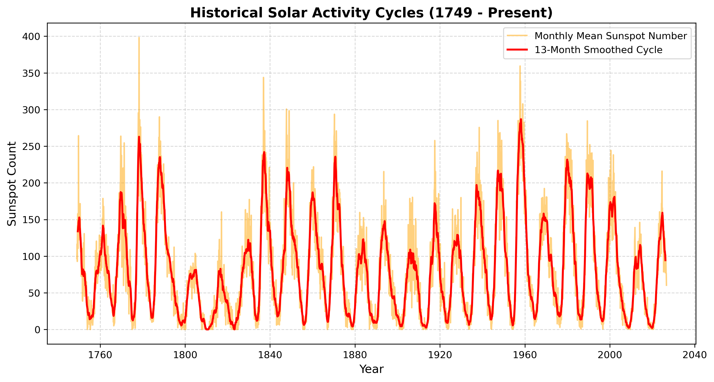

# Historical Solar Cycle Analysis

This project uses Python to ingest, clean, and visualize over 250 years of solar activity data provided by the SILSO World Data Center. By executing time-series smoothing, it highlights the distinct 11-year solar cycles from 1749 to the present day.

## Features
* Processes raw, multi-column scientific text files using `pandas`.
* Applies a 13-month centered rolling average to isolate long-term solar cycles from transient space weather noise.
* Generates publication-ready data plots using `matplotlib`.

## Data Visualisation Output

## How to Run Externally
1. Clone this repository.
2. Ensure dependencies are installed: `pip install pandas matplotlib`
3. Execute the script: `python analyze_solar_cycle.py`

